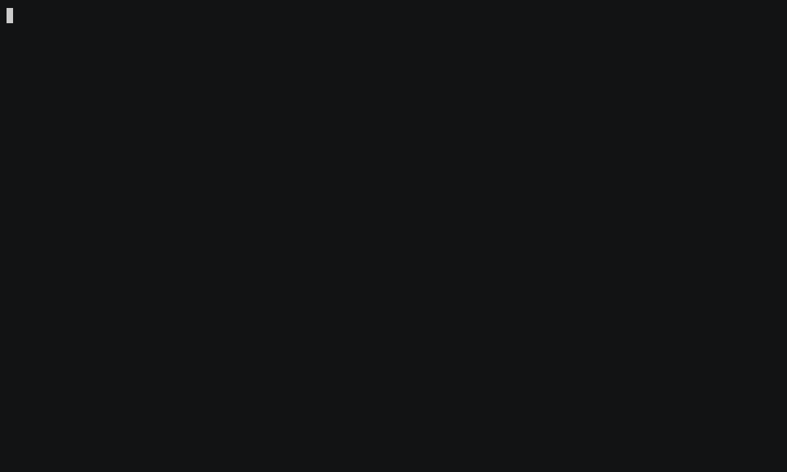

# open-geocode

Fast, lightweight, self-hosted geocoding in pure Rust.

[](https://github.com/open-geocode-rs/open-geocode/actions/workflows/ci.yml)
[](https://crates.io/crates/open-geocode)
[](https://docs.rs/open-geocode)
[](LICENSE)

`open-geocode` is a self-hosted address geocoding engine built entirely on open data (OpenStreetMap and OpenAddresses).
Forward, autocomplete, reverse and batch geocoding, served from one file.

Country-scale indexes build in minutes and serve 10× the queries per second of Pelias and Nominatim.
og is an alternative to commercial API quotas and to the days-long builds of Pelias and Nominatim, whether for a single region or for global geocoding.

**Features**

- **Parser:** semi-Markov CRF, trained on every build from the addresses it serves.
- **Search:** Tantivy index and FST dictionaries, with Levenshtein-automata typo tolerance and Unicode transliteration across scripts. Free-form or structured input.
- **Reverse:** Hilbert-packed R-trees and point-in-polygon on real admin boundaries, returning the nearest address with its full locality, region and country.
- **Results:** calibrated confidence, plus a rooftop, interpolated or street-level accuracy tier.



Building the Luxembourg Pack, then geocoding a CSV of 4,000 addresses:
every row matched in about a second, p50 1.6 ms and p99 5.4 ms.

## Why open-geocode?

Geocoding your address data through a commercial API means per-lookup fees after the free tier, rate limits, and every address sent to a third party.

Nominatim and Pelias, the open-source options, have no batch endpoint and are hard to self-host.
Nominatim needs PostgreSQL with PostGIS, and a planet import takes days on a machine with 64 GB of RAM.

open-geocode runs on your own hardware: drop in a CSV, get it back with coordinates, and no address leaves your network.

There is no PostgreSQL or Elasticsearch to keep running, and an update is a new file swapped in.
Because the file is memory-mapped, og runs on scale-to-zero platforms like Cloud Run or Fly Machines and costs next to nothing between batches.

## Benchmarks

Three geocoders on the same inputs and resources: **open-geocode**, **Nominatim**,
and **Pelias**, each serving the same Ontario OSM extract (~2.03M addresses) in
Docker, one at a time, capped at an identical 4 CPU / 10 GB, over loopback HTTP.
Host: 24-core / 32 GB, Windows 11 + Docker Desktop:

- **Service time**: closed-loop, single client: time for one request with **no
  queue**, so it can't be inflated by overload. This is the honest latency.
- **Throughput**: open-loop: max sustained arrival rate holding **p99 < 100 ms**.

| | open-geocode | Pelias | Nominatim |
| --- | ---: | ---: | ---: |
| Deployable footprint ³ | **1.28 GiB** | 5.88 GiB | 5.92 GiB |
| RAM while serving | **~1.2 GiB** ¹ | 4.60 GiB | 2.75 GiB |
| Forward service-time p50 / p99 | **1.0 / 2.0 ms** | 11.5 / 67.6 ms | 40.0 / 1384.7 ms |
| Reverse service-time p50 / p99 | **1.0 / 1.5 ms** | 5.0 / 9.5 ms | 7.5 / 14.2 ms |
| Forward throughput (req/s @ p99<100ms) | **1000** ² | 100 | 25 |
| Reverse throughput (req/s @ p99<100ms) | **1000** ² | 500 | 100 |
| Addresses indexed | 2,032,851 | 2,036,529 | 2,037,682 |

Single binary, no database or cluster: **~4.6× smaller on disk, lower memory use,
~10–40× higher forward throughput, sub-millisecond latency.**

### Notes

- ¹ open-geocode memory-maps its pack, so process RSS is only ~0.03 GiB but ~1.2 GiB figure is the working set: resident in the OS page cache
- ² open-geocode's true throughput ceiling is higher; the load grid stopped at 1000.
- ³ Measured with the previous multi-file Pack format, where the Ontario Pack was about 1.2 GB.
  The single-file Pack for the same extract is about 0.3 GB; the serving benchmarks have not been re-run with it yet.
- Engines do unequal work per query (Pelias libpostal parsing, Nominatim hierarchy); reported, not corrected.
- Nominatim's forward p99 is a genuine heavy tail under the cap (p50 is 40 ms), not overload.
- Single host: CPU capped, cache/disk shared; ratios travel better than absolute numbers.
- Only the ~2.03M addresses are directly comparable; each engine indexes different extra layers.

## Quickstart

```
cargo install --path . --features tui --bin og
og build --region canada/ontario
og serve canada-ontario
```

Ontario's 2 million addresses build in about a minute on a 24-core machine, then the API serves on `http://127.0.0.1:8080`.
Add `--openaddresses` to `og build` to merge in OpenAddresses points (needs an API token in `OA_TOKEN`).

Run `og` with no arguments for the interactive interface: pick a region, build it, search it, and geocode CSV files.

## Use Cases

| Capability | Example use case |
|---|---|
| Forward geocoding | Turn customer, store, vendor, or service addresses into coordinates |
| Reverse geocoding | Convert fleet, delivery, device, or field-work GPS pings into readable locations using H3 candidate lookup and address-first gates |
| Autocomplete | Power address forms, checkout flows, internal tools, and store locators with Tantivy-native prefix queries |
| POI lookup | Find named businesses, schools, parks, and stations by name and town |
| Batch geocoding | Enrich CSVs, database tables, and large address lists without per-row API pricing |
| Search optimization | Handle messy addresses, abbreviations, partial queries, field-aware matches, interpolation ranges, and ranked candidates |
| Private data | Geocode internal addresses, custom places, service zones, or proprietary datasets |

## License

`open-geocode` is licensed under the [MIT License](LICENSE).

Third-party code dependencies remain under their own OSS licenses. Generated
Packs preserve source metadata needed for attribution and auditability; users are
responsible for following the license terms of the geospatial data they build
from.
